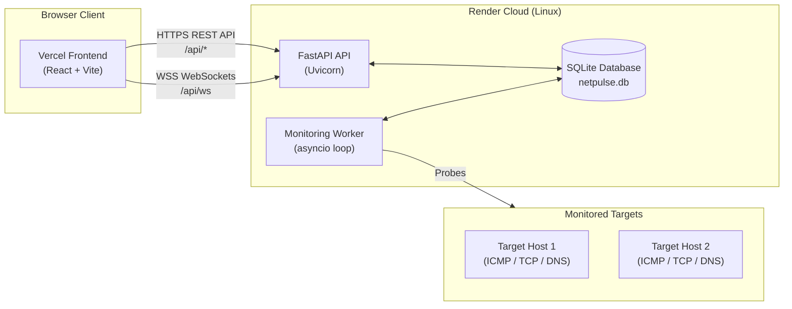

# NetPulse: End-to-End Production Deployment Guide

This guide details the complete deployment setup for **NetPulse** with the backend hosted on **Render** and the frontend hosted on **Vercel**.

---

## 1. Architecture Overview



---

## 2. Configuration Files

1. **`render.yaml`**:
   Render Blueprint configuration defining:
   - Python 3.11 runtime
   - Backend root directory: `backend`
   - Build command: `python -m pip install -r requirements-lock.txt && python -m pip install --no-deps -e .`
   - Start command: `uvicorn netpulse.main:app --host 0.0.0.0 --port $PORT`
   - Health check path: `/api/health`
   - Environment variables: `PYTHON_VERSION`, `CORS_ORIGINS`, `NETPULSE_DATABASE_URL`

2. **`vercel.json` / `frontend/vercel.json`**:
   Vercel Single Page Application rewrite rules ensuring client-side routing and direct URLs resolve to `index.html`.

3. **`backend/netpulse/checks/ping.py`**:
   Cross-platform ping support (`-c 1 -W <sec>` on Linux and `-n 1 -w <ms>` on Windows) so ICMP monitoring works in Render's Linux environment.

---

## 3. Step-by-Step Deployment Instructions

### Step 3.1: Deploy Backend on Render

1. Sign in to your [Render Dashboard](https://dashboard.render.com).
2. Click **New +** and select **Blueprint**:
   - Connect your GitHub repository (`noorzaincs-star/my-project`).
   - Render detects `render.yaml` automatically.
   - For `CORS_ORIGINS`, you can initially leave it or enter your local Vite URL `http://localhost:5173`.
   - Click **Apply**.
   *(Alternatively, if creating a standard **Web Service**: choose root directory `backend`, Python runtime, build command `python -m pip install -r requirements-lock.txt && python -m pip install --no-deps -e .`, start command `uvicorn netpulse.main:app --host 0.0.0.0 --port $PORT`, and health check `/api/health`)*.
3. Once deployed, copy your Render backend URL (e.g. `https://netpulse-backend.onrender.com`).

---

### Step 3.2: Deploy Frontend on Vercel

1. Sign in to your [Vercel Dashboard](https://vercel.com).
2. Click **Add New...** -> **Project**.
3. Import your GitHub repository (`noorzaincs-star/my-project`).
4. Configure Project Settings:
   - **Framework Preset**: `Vite`
   - **Root Directory**: Click **Edit** and select `frontend`.
5. Under **Environment Variables**, add:
   - **Name**: `VITE_API_URL`
   - **Value**: `https://<your-render-service>.onrender.com` *(your Render backend URL, without a trailing slash)*.
6. Click **Deploy**.
7. Copy your Vercel URL (e.g. `https://<your-project>.vercel.app`).

---

### Step 3.3: Complete CORS Handshake on Render

1. Return to [Render Dashboard](https://dashboard.render.com) -> your backend service -> **Environment**.
2. Set or update `CORS_ORIGINS`:
   ```env
   CORS_ORIGINS=https://<your-project>.vercel.app
   ```
   *(Multiple origins can be separated by commas, e.g. `https://<your-project>.vercel.app,http://localhost:5173`)*.
3. Save changes. Render will automatically redeploy with the allowed frontend origin.

---

## 4. Verification

| Check | URL | Expected Result |
| :--- | :--- | :--- |
| **API Health** | `https://<render-backend>/api/health` | `{"status":"ok","database":"ok","version":"0.1.0"}` |
| **OpenAPI Docs** | `https://<render-backend>/docs` | Swagger UI loaded |
| **Dashboard** | `https://<vercel-frontend>` | NetPulse dashboard loaded with **LIVE** indicator |

