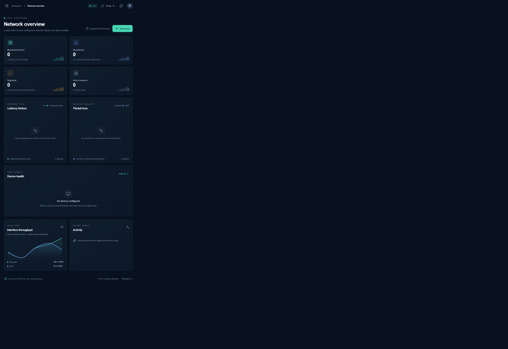

# NetPulse

NetPulse is a local-first network monitoring and diagnostics application. It runs real ICMP, TCP, and DNS checks only for targets you explicitly configure, stores results in local SQLite, and presents measured data in a React dashboard. Empty, stale, and failed checks remain distinct; there is no fabricated live or demo data.

## Running application



This screenshot shows the live dashboard with no configured devices; interface throughput is measured from the local host.

## Features

- Device create/edit/delete, pause/resume, search, sorting, and manual checks.
- Scheduled ICMP, TCP, and DNS checks with per-device interval, timeout, and ping count.
- Consecutive-failure and recovery confirmation before device state and incident transitions.
- Persisted, paginated measurements and incidents; deduplicated active incidents.
- WebSocket updates with reconnect/backoff and REST polling fallback.
- Local-host interface counters and rates from psutil, clearly labeled as not per-device bandwidth.
- Manually configured topology links only; physical connectivity is never inferred from ping.
- FastAPI OpenAPI documentation and a responsive React dashboard.

## Run on Windows

Install Python 3.11 or newer and Node.js 20 or newer. Run these one-time setup commands in PowerShell from the project root:

```powershell
py -3.11 -m venv backend\.venv
backend\.venv\Scripts\python.exe -m pip install -r backend\requirements-lock.txt
backend\.venv\Scripts\python.exe -m pip install --no-deps -e .\backend
Set-Location frontend
npm ci
```

To start NetPulse, open **two PowerShell windows** at the project root.

**Window 1 — API and monitoring worker:**

```powershell
Set-Location backend
.\.venv\Scripts\python.exe -m uvicorn netpulse.main:app --host 127.0.0.1 --port 8000
```

**Window 2 — web dashboard:**

```powershell
Set-Location frontend
npm run dev
```

Keep both windows open. Open `http://127.0.0.1:5173` for the dashboard or `http://127.0.0.1:8000/docs` for the API documentation. Press **Ctrl+C** in each window to stop its service. The SQLite database is created at `backend\netpulse.db` on first start.

Optionally, copy `.env.example` to `.env` in the project root to configure local limits.

### Test public demo mode locally

Demo mode requires a private `ADMIN_TOKEN` with at least 32 characters. In PowerShell, from the project root, set these values in the API window before starting the backend:

```powershell
$env:NETPULSE_DEMO = "true"
$env:ADMIN_TOKEN = "replace-with-a-private-random-token-at-least-32-characters"
Set-Location backend
.\.venv\Scripts\python.exe -m uvicorn netpulse.main:app --host 127.0.0.1 --port 8000
```

In another window, start the frontend as above and open `http://127.0.0.1:5173`. Only the real `google.com` and `8.8.8.8` targets are seeded; the first measurements appear after actual TCP/DNS probes finish. No ICMP checks, sample measurements, or fake readings are created. Demo mode hides all write controls; API mutations require `Authorization: Bearer <ADMIN_TOKEN>` with the configured private token.

## Free hosted deployment

Hugging Face Docker Spaces require a paid plan. For a no-card setup, use the free static Hugging Face Space for the dashboard and a free Render web service for the API. Render's free service may sleep when idle and uses an ephemeral filesystem, so it can have a cold start and SQLite history can reset after restarts.

1. Deploy the backend from this GitHub repository using the root `render.yaml` Blueprint (`New` → `Blueprint` on Render). Choose the free plan when prompted. The Blueprint enables `NETPULSE_DEMO=true`, restricts CORS to this dashboard, and generates a private `ADMIN_TOKEN`.
2. In Render, copy the backend's public URL, for example `https://netpulse-backend.onrender.com`.
3. In the Hugging Face Space **Settings → Variables**, set `NETPULSE_API_URL` to that backend URL (no trailing slash). The frontend derives both REST and WebSocket URLs from it.
4. The dashboard is at https://noorzan-netpulse-network-monitor.static.hf.space/. It shows real measurements once scheduled TCP/DNS checks have run; demo mode seeds only the two allowed targets and never inserts sample measurements.

Do not set `ADMIN_TOKEN` as a frontend/Space variable. It is generated and kept private by the Render backend. The backend remains read-only to public visitors.

## Deploy on Render and Vercel

The API and frontend are deployed separately. Set the API origin (without `/api`) as the Vite build-time variable `VITE_API_URL`; the frontend derives its REST, WebSocket, and API-docs URLs from it.

### Render — backend

- **Root Directory:** `backend`
- **Build Command:** `python -m pip install -r requirements-lock.txt && python -m pip install --no-deps -e .`
- **Start Command:** `uvicorn netpulse.main:app --host 0.0.0.0 --port $PORT`
- **Environment:** set `CORS_ORIGINS` to the exact frontend origin, for example `https://netpulse.vercel.app`. Add comma-separated origins only for frontend deployments that should be allowed. Render's `RENDER_EXTERNAL_HOSTNAME` is accepted for the API host; set `NETPULSE_ALLOWED_HOSTS` to comma-separated hostnames if using a custom API domain.

### Vercel — frontend

- **Root Directory:** `frontend`
- **Install Command:** `npm ci`
- **Build Command:** `npm run build`
- **Output Directory:** `dist`
- **Environment Variable:** `VITE_API_URL=https://<your-render-service>.onrender.com`

Vercel builds the static site; it does not need a separate start command. Set `VITE_API_URL` in the Vercel project settings and redeploy after changing it. The URL must be the API origin, with no trailing slash or `/api`. Set `CORS_ORIGINS` on Render to the corresponding Vercel origin.

**Deployment limitations:** Local mode is intentionally unauthenticated and is for localhost use. Enable public demo mode before exposing the API; CORS and allowed-host checks alone are not authentication. SQLite on a typical Render filesystem is ephemeral, so data can be lost when a free service restarts or spins down.

### Public read-only demo mode

Enable the hosted demo with `NETPULSE_DEMO=true` and a private `ADMIN_TOKEN` of at least 32 characters. In demo mode, public reads show only the two allowlisted targets, `google.com` and `8.8.8.8`; all API mutations require the bearer token. The frontend hides mutation controls. Startup configures TCP/443 checks for both targets and DNS checks for `google.com`; it inserts no measurements. Keep the token in the hosting platform's secret settings, never in source control. For local testing, follow [Test public demo mode locally](#test-public-demo-mode-locally).

## Test and build

```powershell
# Backend, from backend\
python -m pytest -q

# Frontend, from frontend\
npm test
npm run build
npm audit
```

## Configuration and safety

See [.env.example](.env.example) for local defaults and deployment variables, including CORS origins. The service binds to loopback by default; only the configured Render host is accepted when deployed, and remote WebSocket clients must send an explicitly allowed origin. Do not expose it without authentication and a deliberate security review.

Add only devices and TCP ports you own or are authorized to monitor. NetPulse does not discover devices, scan address ranges, or execute arbitrary commands. Ping uses argument-list subprocess calls without a shell. Windows Firewall, endpoint policy, DNS configuration, and target-side filtering can block checks; a failed check is evidence of a failed probe, not proof that a device is offline or a root cause.

## Data and limitations

- Schema initialization uses SQLAlchemy `create_all` and applies an idempotent additive migration for device check-count and timeout columns. Back up `backend\netpulse.db` before upgrading. Other future schema changes must include explicit migrations.
- Measurement retention is applied in batches; incident records are retained.
- ICMP availability and latency depend on the target and Windows network policy. TCP and DNS measurements reflect only the configured endpoint or resolver.
- The topology graph displays registered devices and manually configured links only.
- Local interface counters measure the host's network interfaces, not an individual device's bandwidth.

## Documentation

- [Architecture](docs/architecture.md)
- [Implementation plan and verified milestones](docs/implementation-plan.md)
- [REST and WebSocket API](docs/api.md)
- [Database schema and retention](docs/database.md)
- [Illustrative incident report][def]

[def]: docs/sample-incident-report.md