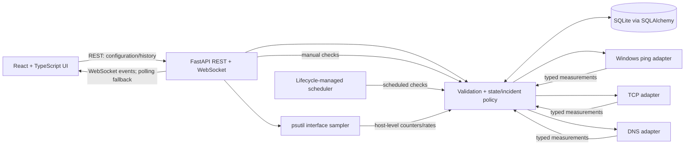

# NetPulse architecture

NetPulse is planned as a localhost-only web client backed by a lifecycle-managed Python service. Network observations originate only from configured checks; the browser renders persisted results and marks unavailable or stale values explicitly.

## Boundaries and guarantees

- A configured device is not evidence that it is currently reachable. Only completed checks produce measurements.
- ICMP, TCP, and DNS outcomes are independent. Ping failure alone does not establish that a device is down.
- Interface counters describe the local host's network interfaces, not per-device bandwidth.
- Topology edges are manually configured. Ping and TCP outcomes do not discover physical network links.
- Staleness, unavailable measurements, and check errors remain distinct from live successful results.
